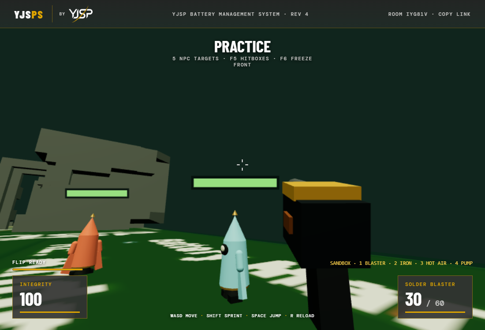
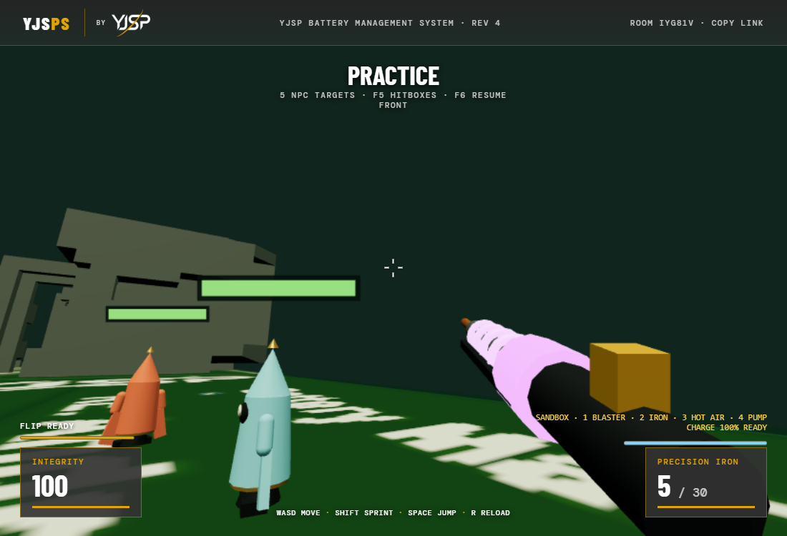
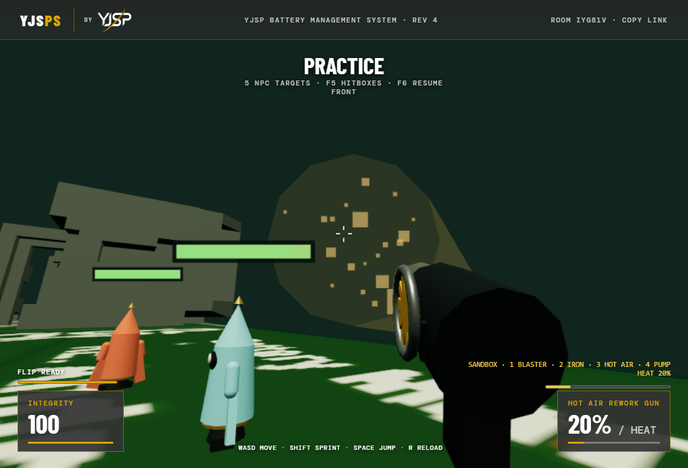
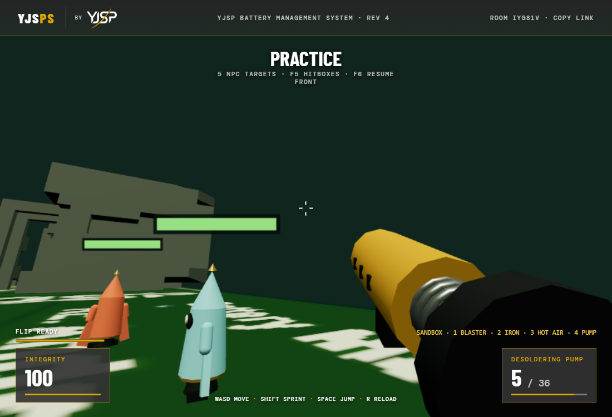
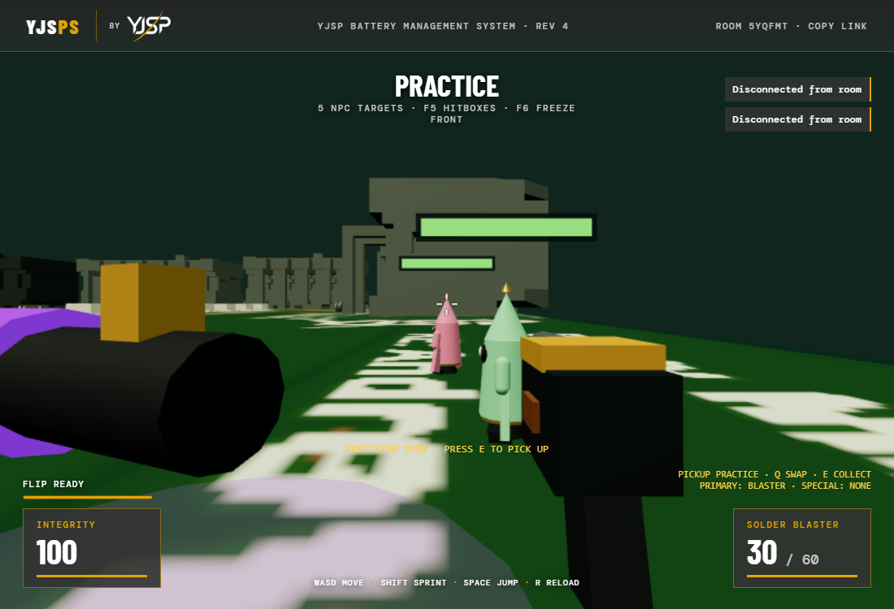

# Weapon overhaul — real BMS browser captures

These screenshots come from the automated Chrome run in Solo Practice.
All four models use different geometry, with shared cached primitive geometry
and common industrial materials. Visual transforms never modify combat rays.

| Solder Blaster — pistol housing and raised heated barrel | Precision Iron — charged chamber and six coils |
| --- | --- |
|  |  |
| Hot Air — side turbine, nozzle and heat stream | Desoldering Pump — cylindrical body, spring and rear plunger |
|  |  |

## Authoritative charge progression

Compare [idle](screenshots/weapon-overhaul/weapon-iron-idle.png),
[partial charge](screenshots/weapon-overhaul/weapon-iron-partial.png), and
[full charge](screenshots/weapon-overhaul/weapon-iron-charged.png).
The model pulls back, compresses its barrel and progressively lights coils.
The bright full-charge state is accompanied by the existing audio cue.

## Pickup Practice

The browser test collects the nearby Iron, swaps to the permanent Blaster
and back with Q, and confirms that unowned number-key selection is rejected.
Server tests additionally cover replacement, distance, stale versions,
respawning, ammunition preservation and death/reset.
